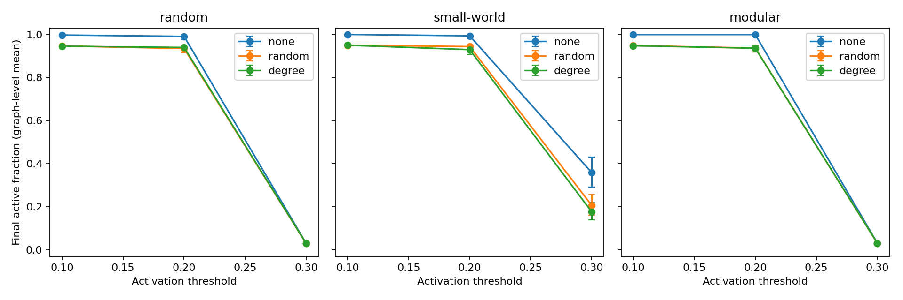
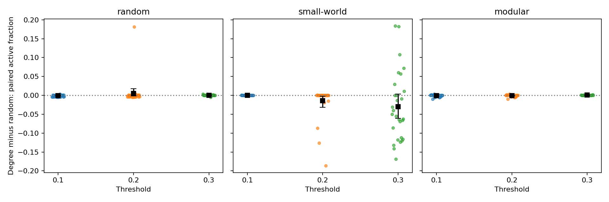
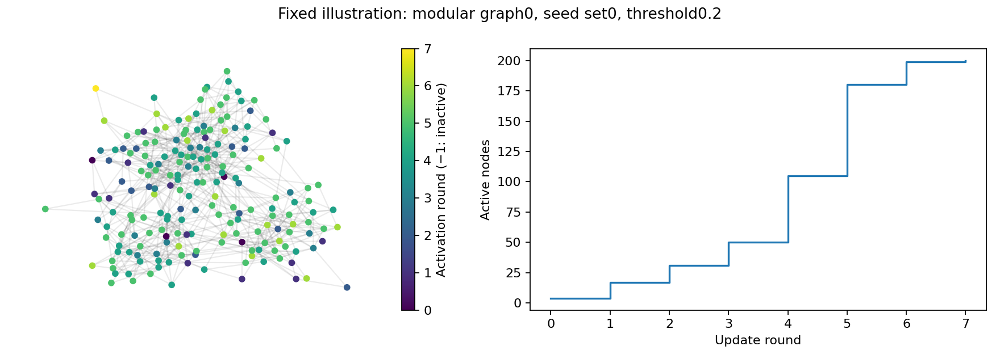

# Threshold Cascades in Networks

**A paired experiment on topology, activation thresholds and node protection.**

I tested a seemingly reasonable intervention: protect the most connected nodes to stop a disturbance spreading. The answer depends on the network and the threshold. Degree alone does not provide a universal ranking.



## One rule, three network families

An inactive node activates when enough of its neighbours are active. Updates are synchronous and activation is irreversible. Protected nodes remain inactive, but their edges stay in neighbours' denominators—this is not node removal.

I compare random, small-world and modular graphs with the same **200 nodes and 600 edges**. Each graph receives four initially active nodes. The policies protect no nodes, ten random nodes or ten highest-degree nodes, excluding the seeds.

The primary experiment contains **4,050 runs**: three families × 30 graphs × five seed sets × three thresholds × three policies. Seeds and protection choices are reused across thresholds; policy comparisons are paired. I average seed sets within each graph before estimating uncertainty. The 30 graph realisations, rather than nodes or rounds, are the replication units.

## Where targeting degree helps



At threshold 0.2 in small-world graphs, degree-based protection reduced the mean active fraction by **0.0144** more than random protection; the graph-bootstrap interval was **[−0.0317, −0.0024]** for degree minus random. On random graphs at the same threshold, that contrast was **+0.0050**, with an interval spanning zero.

At threshold 0.3, cascades in the random and modular generators were already small, leaving little spread to prevent. A protection policy can look ineffective simply because the unprotected process rarely propagates. The saved tables include final size, duration, large-cascade frequency and all paired contrasts, including near-zero differences.

Intervals describe variability under these synthetic generators; they are not estimates for a real population. Matching edge counts does not isolate a causal effect of a single structural property: degree distributions, clustering and connectivity also differ.

## An inspectable example



This is the prespecified modular graph 0, seed set 0 and threshold 0.2, with no protection. It was not selected for a dramatic result. The repository saves every primary graph's edges. An exploratory budget comparison uses five and twenty protected nodes on the first ten graphs of each family; it is kept separate from the primary analysis. In the small-world subset at threshold 0.3, degree/random mean active fractions were 0.2755/0.3191 at budget 5 and 0.1121/0.1123 at budget 20. The difference between targeting rules nearly vanished at the larger budget.

```bash
python -m venv .venv
source .venv/bin/activate
pip install -r requirements.txt
python analysis.py
python -m unittest discover -s tests -v
```

Tests cover hand-solvable paths, no-seed behaviour, permanent protection, irreversible activation, isolated nodes, label invariance and exact graph sizes. [protocol.md](protocol.md) records construction, pairing and bootstrap rules; the notebook displays the results.

## Scientific scope

[Watts (2002), *A simple model of global cascades on random networks*](https://www.stat.berkeley.edu/~aldous/260-FMIE/Papers/watts.pdf), is the foundation for the threshold mechanism. The graph families and protection experiment here are a bounded extension for exploration, not a reproduction of all its theory.

All data are simulated. A biomedical application would need a defensible activation mechanism, measured connections and recovery or adaptation where relevant. This project demonstrates network simulation and paired statistical analysis; it does not train a graph neural network or model infection.
